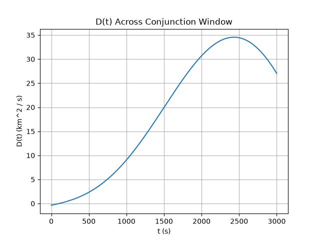

# Monte Carlo Orbital Conjunction

A Python numerical simulation package for two-body orbital propagation, bracket-cached Time of Closest Approach (TCA) root-finding, and parallelized Monte Carlo satellite collision probability ($P_c$) estimation.

## Overview

Evaluating collision risk between orbiting spacecraft and debris requires propagating uncertain state vectors forward in time, pinpointing the exact moment of closest approach, and estimating the probability that minimum separation falls below a combined hard-body radius ($R_{\text{HBR}}$).

This repository implements a modular numerical pipeline built from first principles:
* **Two-Body Orbital Dynamics (`orbital.dynamics`):** Cartesian gravitational equations of motion in Earth-Centered Inertial (ECI) coordinates.
* **4th-Order Runge-Kutta Integrator (`orbital.integrators`):** Fixed-step RK4 numerical solver with boundary-clamped time stepping to prevent final-step overshoot.
* **Cached TCA Bisection Solver (`orbital.conjunction`):** Detects sign changes in the range-rate indicator $D(t) = \mathbf{r}(t) \cdot \mathbf{v}(t) = 0$ (using relative position and velocity). Includes both a baseline solver (`score`) and a bracket-cached multi-root solver (`score_optimized`) that propagates from saved bracket endpoints rather than restarting from $t_0$ on every bisection iteration.
* **Parallel Monte Carlo & Importance Sampling (`orbital.probability`):** Evaluates rare-event collision probabilities across $N$ uncertain 12D joint initial states using `multiprocessing.Pool`, computing empirical $P_c$, sample variance, 95% confidence intervals, and statistical relative error.

## Methodology & Engineering Progression

The numerical architecture evolved across three progressive stages to eliminate computational bottlenecks in multi-day collision screening:

1. **Deterministic Orbital Propagation:** Built a custom 4th-order Runge-Kutta (RK4) integrator from first principles to propagate spacecraft and debris state vectors under two-body dynamics, using clamped boundary steps to guarantee exact evaluation at target timestamps.
2. **Bracket-Cached TCA Root-Finding:** Formulated closest-approach detection as a root-finding problem on the range-rate indicator $D(t) = 0$. To make multi-day horizons feasible inside Monte Carlo loops, the baseline solver (`score`) was refactored into `score_optimized`, caching state vectors at coarse-grid bracket endpoints so bisection sub-steps propagate only across a single step interval rather than re-integrating from $t_0$.
3. **Parallel Rare-Event Estimation:** Wrapped the cached TCA solver inside a `multiprocessing.Pool` importance sampling and crude Monte Carlo framework (`importance_sampling`) to distribute independent 12D state perturbations across multi-core CPU architectures and quantify estimator variance and confidence bounds.

## Example Output: TCA Root-Finding

To pinpoint the Time of Closest Approach (TCA), the solver tracks the relative range-rate indicator:

$$D(t) = \mathbf{r}_{\text{rel}}(t) \cdot \mathbf{v}_{\text{rel}}(t)$$

across the conjunction window, brackets sign changes where $D(t) = 0$, and refines the root via bisection to locate the minimum separation distance $d_{\min}$:



> Range-rate indicator $D(t)$ evaluated over a 3,000 s two-body propagation window; zero-crossings ($D(t) = 0$) bracket candidate local extrema in relative separation.

## Repository Structure

```text
monte-carlo-orbital-conjunction/
├── pyproject.toml
├── LICENSE
├── assets/
│   └── D_of_t.png
├── src/
│   └── orbital/
│       ├── dynamics.py       # Cartesian two-body equations of motion
│       ├── integrators.py    # Classical RK4 integrator and propagation loop
│       ├── conjunction.py    # Relative geometry, D(t) indicator, score(), and score_optimized()
│       └── probability.py    # Parallelized importance sampling & crude Monte Carlo estimator
└── examples/
    ├── runtime_score_comparison.py   # Speedup benchmark: baseline score() vs. score_optimized()
    └── mc_conjunction_symmetric.py   # 1-day conjunction Monte Carlo sample-size convergence study
```

## Quickstart

Clone the repository and install the package locally in editable mode:

```bash
git clone [https://github.com/Rayan36l/monte-carlo-orbital-conjunction.git](https://github.com/Rayan36l/monte-carlo-orbital-conjunction.git)
cd monte-carlo-orbital-conjunction
pip install -e .
```

Run the bracket-caching runtime benchmark:

```bash
python examples/runtime_score_comparison.py
```

Run the parallelized Monte Carlo collision probability study:

```bash
python examples/mc_conjunction_symmetric.py
```

## Research Context & Data Governance

These numerical solvers were developed during undergraduate astrodynamics research at the **Astrodynamics, Space, and Robotics Laboratory (ASRL)** at the University of Central Florida, in support of rare-event satellite collision probability research aligned with **NASA Conjunction Assessment Risk Analysis (CARA)** workflows and high-performance parallel Monte Carlo simulation on the UCF Stokes HPC cluster.

**Confidentiality & Synthetic Data Notice:** To comply with research confidentiality agreements and operational data restrictions, no proprietary NASA CARA conjunction data messages (CDMs), restricted space-catalog ephemerides, or internal lab scripts are included in this repository. All orbital state vectors, covariance matrices, and benchmark scenarios in `examples/` are fully synthetic test cases constructed solely to validate and demonstrate the underlying numerical algorithms.
